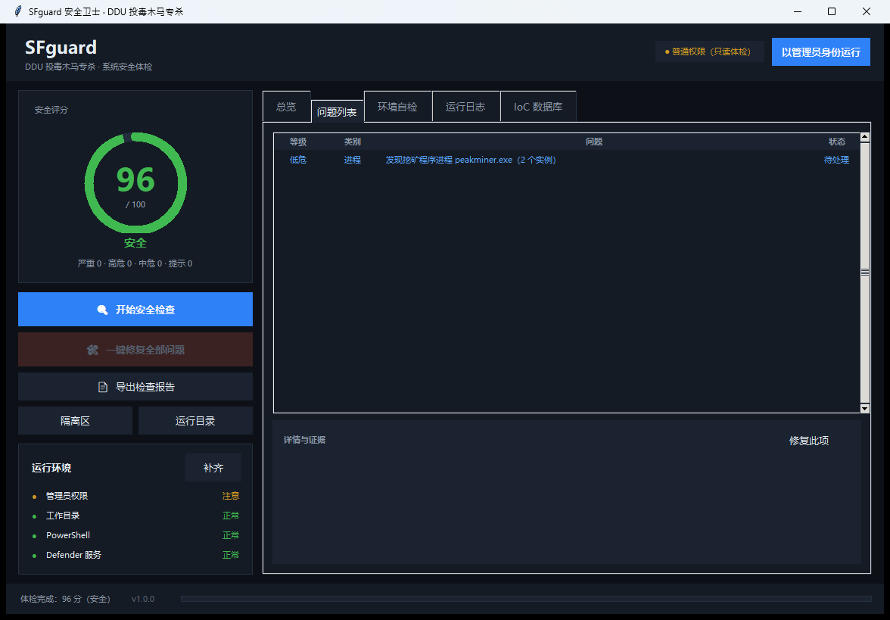

# SFguard — 假 DDU 投毒木马专杀 / Fake-DDU Trojan Cleaner

**针对 2026-11-24 首次出现的「假 DDU 安装包 → 隐藏挖矿木马」的 Windows 体检、清理与修复工具。**
单文件、免安装、离线运行、不收集任何数据。

*A single-file Windows tool that detects and cleans the "fake DDU installer → hidden
crypto-miner" family first seen on 2026-11-24, and repairs the system settings it tampers with.*



---

> ## ⚠️ 重要警告 / IMPORTANT WARNING
>
> **这是一个新出现的病毒家族，目前非常活跃，并且还在不断产生新的变体。**
> 攻击者在两天内就更换过文件哈希，检测特征随时可能滞后，本工具的规则也可能漏检最新变种。
>
> **This is a NEW malware family. It is highly active and continuously producing new
> variants — the payload hash changed within two days. Detection may lag behind, and this
> tool may miss the newest variants.**
>
> - 使用本软件前请先备份重要数据，**谨慎使用，风险自负**。
> - 体检结果只能作为参考，不能替代专业安全产品与人工分析。
> - 若机器曾遭受管理员级 / 内核级控制，最彻底的做法是重装系统并修改密码。
> - **Back up your data first. Use at your own risk.** Scan results are for reference only
>   and do not replace professional security products or manual analysis.

---

## 它做什么 / What it does

| 组 | 内容 |
|---|---|
| 进程 | 恶意进程名、伪装系统组件、异常运行目录、挖矿命令行特征 |
| 文件 | 载荷目录、`Caches\<8位十六进制>`、特征文件组合、已知样本 SHA-256 |
| 持久化 | 计划任务、Run 键、启动目录、服务、WMI 订阅、IFEO / AppInit / Winlogon |
| 防御 | Defender 状态与排除项、策略篡改、UAC、hosts、代理、防火墙 |
| 网络 | 木马监听端口（61160 / 42842）、可疑外连 |
| 残留 | 安全软件历史记录、下载目录样本、WinRing0 驱动 |
| 环境 | 权限、目录、PowerShell、安全服务、磁盘、待重启、外网 |

7 组、40 余项检查。清理动作可回滚：文件只**隔离**不删除（附 SHA-256 清单）、
注册表修改前自动备份、hosts 修改前保留备份、修复后自动复检并重新评分。

## 快速开始 / Quick start

1. 下载 `SFguard.exe`，放到任意目录双击运行（Windows 10 1809+ / Windows 11，x64）。
2. 等待自动体检（5–15 秒），查看评分与问题列表。
3. 需要修复时点「一键修复全部问题」，通过 UAC 提权；完成后重启一次。

> 无商业代码签名：SmartScreen 提示时点「更多信息 → 仍要运行」。
> 部分杀软可能对 PyInstaller 单文件程序启发式误报——源码完整公开，可自行复现构建。

### 双击没反应？ / Nothing happens on double-click?

单文件程序启动时需要解包到 `%TEMP%`。如果程序所在的文件夹带有**低完整性（Low integrity）**
或沙箱标签（少数安全环境、容器目录、部分同步盘会有），Windows 会禁止解包，表现为闪一下就退出。
请改为双击 **`Run-SFguard.bat`**：它会把程序复制到 `%LOCALAPPDATA%\SFguard` 再启动，可绕开该限制。

*The single-file build unpacks itself to `%TEMP%` at startup. If the folder carries a
Low-integrity / sandbox label, unpacking is blocked and the app exits immediately.
Double-click **`Run-SFguard.bat`** instead — it copies the exe to `%LOCALAPPDATA%\SFguard`
and starts it from there.*

### 命令行 / CLI

```powershell
.\SFguard.exe                          # GUI
.\SFguard.exe --scan --report .\out    # 只读体检 + 导出报告
.\SFguard.exe --fix                    # 体检并修复（需要管理员）
.\SFguard.exe --selftest               # 18 项内置自检
```

## 目录 / Repository layout

```
├─ SFguard.exe                    主程序 / main executable
├─ Run-SFguard.bat                启动器（双击 exe 无反应时用）
├─ README.md                      本文件 / this file
├─ 使用说明.md                    完整使用手册 / full manual
├─ 中毒自查与上报指南.md           中毒后的排查与上报流程
├─ 原创声明.md                    原创性声明（中文）
├─ ORIGINALITY-STATEMENT.md       Statement of Originality (English)
├─ LICENSE.md                     使用许可与免责声明
├─ IoC清单.json                   本次家族特征 / indicators
├─ 界面截图.png
├─ 校验和.txt                     全部文件 SHA-256
├─ 生成校验信息.ps1               行数 / 源码树指纹 / exe 哈希重算
├─ .gitignore / .gitattributes
└─ 源码/                          完整源码 + build.ps1
```

## 原创与许可 / Originality & licence

- 开发者 / Developer: **SiberianFores**
- 发布日期 / Release date: **2026-11-26**
- 原创声明 / Originality: [原创声明.md](原创声明.md) ｜ [ORIGINALITY-STATEMENT.md](ORIGINALITY-STATEMENT.md)
- 许可与免责 / Licence & disclaimer: [LICENSE.md](LICENSE.md)

允许个人与单位免费使用、复制原样副本、审阅与修改源码；
禁止用于攻击他人系统，禁止重新打包冒充官方版本，禁止商业销售。

## 免责声明 / Disclaimer

本软件按「现状」提供，不附带任何担保。**使用本软件造成的任何后果由使用者自行承担，
开发者不承担责任**。开发者亦不对任何人（包括第三方）对本软件所做的修改及其后果承担责任。
请先备份数据，谨慎使用。

*This software is provided "as is", without warranty of any kind. **The developer accepts
no responsibility for any consequences arising from the use of this software.** The
developer is likewise not responsible for any modifications made to this software by
anyone (including third parties), nor for their consequences. Back up your data and use
with caution.*

## 联系 / Contact

781028500@qq.com

## 校验 / Verify

```
5B7F7303F8AB71A42E5FE69A191E25B5DBF770E5DC30AD0B7E2B78C82215C63A  SFguard.exe
```

完整清单见 [校验和.txt](校验和.txt)。

---

**Developer: SiberianFores · V1.0.0 · released 2026-11-26**
